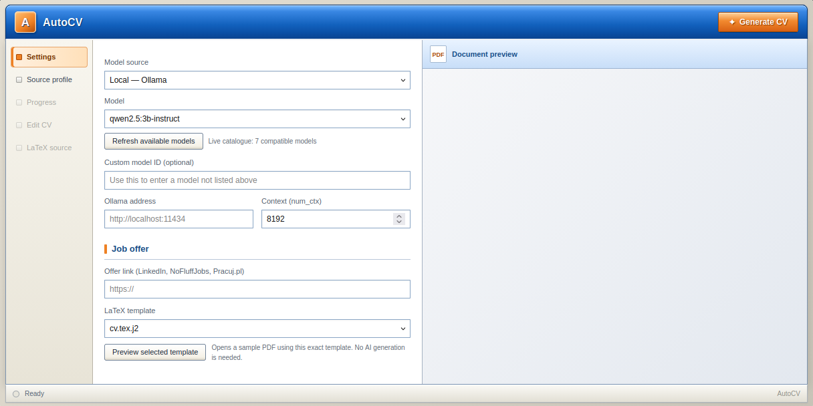
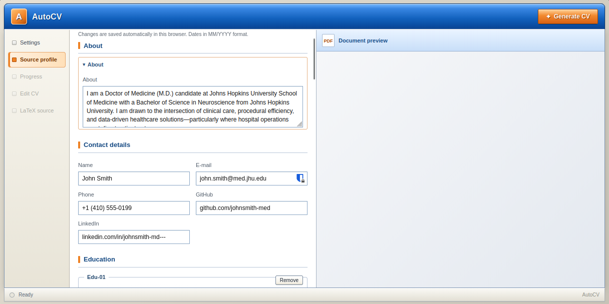
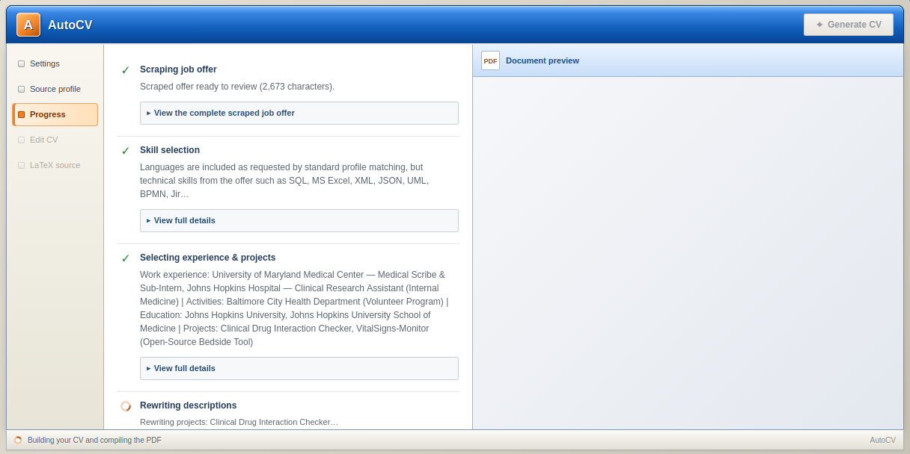
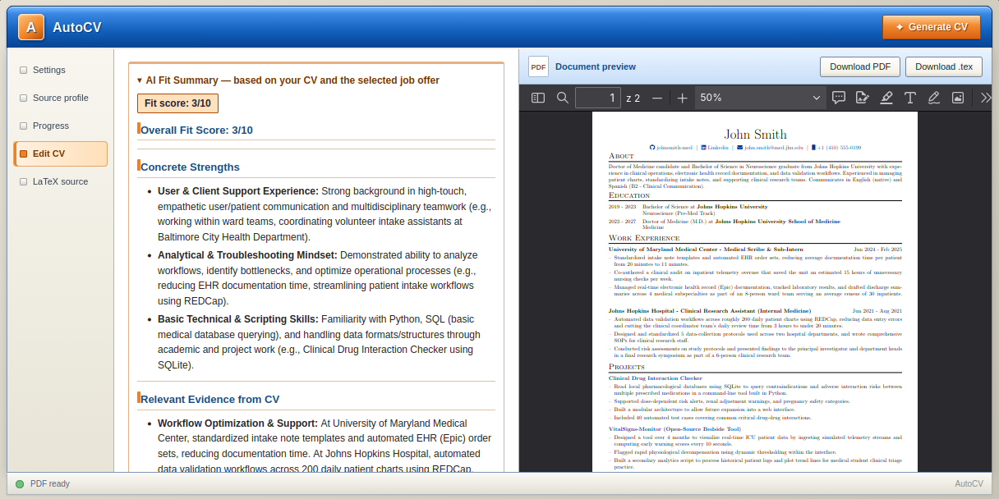
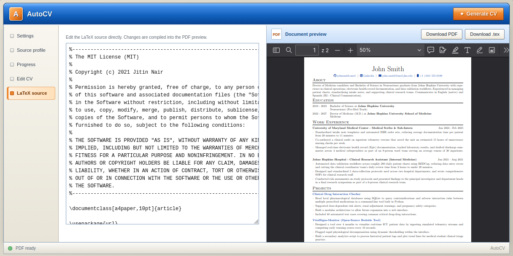

<div align="center">

# 📄 Auto-CV

[](https://www.python.org/downloads/)
[](https://github.com/astral-sh/uv)
[](https://fastapi.tiangolo.com/)
[](https://ollama.com/)
[](https://www.latex-project.org/)

*A Python-based tool that tailors your CV to a specific job offer. You describe your entire career once in a structured biography file, and Auto-CV uses an LLM (local or via API) to pick the most relevant parts, rewrite them for the target position and render the result through a LaTeX template. Use it from the command line or from the built-in web interface.*

</div>

---

## ⚙️ How it works

Auto-CV takes two inputs: a biography file (see [Job schema](#-job-schema)) and the link to a job offer (LinkedIn, NoFluffJobs or Pracuj.pl). The offer is scraped automatically, so there is no need to copy it by hand.

The pipeline consists of the following steps:

### 1. Fetch the offer and parse the biography

The job offer is downloaded from its URL. The biography file is parsed into a structured profile (person, education, work experience, projects, activities, skills, hobbies). Every entry gets a unique ID such as `Work-01` or `Proj-02`.

### 2. Extract relevant skills

An LLM agent compares your skills with the job offer and returns them as a structured, categorized result. Only skills that matter for the position make it to the final CV.

### 3. Select the best entries

A second agent chooses which work experiences, activities, education entries and projects are the most relevant for the offer. The output is constrained to a schema built dynamically from the IDs found in your biography, so the model can only select entries that actually exist and cannot invent new ones.

### 4. Rewrite descriptions

Each selected work experience, activity and project is rewritten by a "ghost writer" agent to highlight what the employer is looking for, based strictly on the facts from your original description.

### 5. Generate the About section

A further agent writes a short, personalized "About me" section using your base summary, the job offer, the selected facts and the selected skills.

### 6. Render the CV

The tailored profile is passed to a [Jinja2](https://jinja.palletsprojects.com/) template and rendered into a LaTeX document, which is compiled into a PDF.

### 7. AI fit assessment *(web interface only)*

Once the PDF is ready, the model compares your complete biography with the offer and writes a short assessment: an overall fit score out of 10, strengths, gaps and the most valuable improvements. It runs in the background, so you can start editing the CV straight away.

---

## 🛠️ Prerequisites & installation

The project requires:

- **Python 3.11** or newer
- A **language model**, either:
  - local, through **[Ollama](https://ollama.com/)** installed and running, or
  - remote, through an API key for **Google Gemini**, **OpenAI**, **Anthropic** or any **OpenAI-compatible** endpoint (OpenRouter, vLLM, …)
- A LaTeX distribution with `latexmk` (e.g. TeX Live, MiKTeX) to compile the generated `.tex` file into a PDF

It is highly recommended to run the project using the [uv package manager](https://github.com/astral-sh/uv):

```bash
uv sync
```

The web interface additionally needs `fastapi`, `uvicorn` and `requests`. If they are not listed in `pyproject.toml` yet, add them:

```bash
uv add fastapi uvicorn requests
```

Provider integrations are imported only when selected, so install just the ones you use:

| Provider | Package |
| -------- | ------- |
| Google Gemini | `langchain-google-genai` |
| Ollama | `langchain-ollama` |
| OpenAI / OpenAI-compatible | `langchain-openai` |
| Anthropic | `langchain-anthropic` |

For a local model, pull one with Ollama, for example:

```bash
ollama pull qwen2.5:3b-instruct
```

> 💡 Small local models are fast, but larger ones (for example `qwen3:30b-a3b`) or hosted models give noticeably better rewrites if your hardware or budget allows it.

### API keys

Enter the key in the web interface, or leave the field empty and export it before starting the server (or the CLI):

```bash
export GOOGLE_API_KEY=...      # Gemini
export OPENAI_API_KEY=...      # OpenAI
export ANTHROPIC_API_KEY=...   # Anthropic
```

---

## 🖥️ Web interface

Start the server from the project root (the prompt paths are relative to it):

```bash
uv run uvicorn server:app --reload
```

Then open <http://127.0.0.1:8000>.

The window is split in two: the workspace with tabs on the left and a live PDF preview on the right.

### Settings

Choose the model source (Gemini, OpenAI, Anthropic, OpenAI-compatible or local Ollama), pick a model from the live catalogue or type a custom model ID, paste the job offer link and select a LaTeX template. A sample PDF of the selected template can be previewed before generating anything.



### Source profile

Build your `job_schema.md` in a form, import an existing `.md`/`.txt` file or download the result. Changes are saved automatically in the browser.



### Progress

Follow every stage of the pipeline live. Each stage can be expanded to read the scraped offer, the model's reasoning for its selections and the rewritten texts.



### Edit CV

Edit the generated CV (summary, skills, work experience, projects, activities, education) and watch the PDF recompile after each change. Entries can be added or removed. The AI fit assessment appears here when it is ready.



### LaTeX source

Edit the generated LaTeX directly; it is compiled into the preview as you type.



### Temporary files

Every generation creates a working folder `jobs/<id>/` with the `.tex`, the PDF and LaTeX auxiliary files. These are removed automatically:

- on server start and shutdown, everything in `jobs/` is deleted,
- while the server runs, folders idle for 24 hours are deleted (checked every 10 minutes). Change the limit with `AUTOCV_JOB_TTL_HOURS`, e.g. `AUTOCV_JOB_TTL_HOURS=2 uv run uvicorn server:app`.

Download your PDF or `.tex` from the preview bar before closing the session. Consider adding `jobs/` to `.gitignore`.

---

## ⌨️ Command line

The original command line workflow is still available. Prepare your biography file and run:

```bash
uv run main.py job_schema.md job_offer_url
```

You can also customize the output directory and the template:

```bash
uv run main.py job_schema.md job_offer_url --out-dir build --template cv.tex.j2
```

#### 📋 CLI arguments

- `filename` : Path to the candidate profile (biography) file (required)

- `job_offer` : URL of the job offer (required, supported sites: LinkedIn, NoFluffJobs, Pracuj.pl)

- `--out-dir` : Output directory for the generated CV (default: `build`)

- `--template` : Name of the Jinja template used for rendering (default: `cv.tex.j2`)

> 💡 The CLI model is configured in `main.py` (by default Gemini `gemini-3.1-flash-lite`, with a local Ollama setup left as a commented-out alternative). The web interface lets you choose the model without editing code.

---

## 🧾 Job schema

`job_schema.md` is an example biography file that shows the exact format Auto-CV expects. The parser relies on this structure, so it has to be preserved - otherwise the profile will not be read correctly. Replace the sample content (a fictional medical student profile) with your own data, but keep the section names, the field names and the ID numbering. In the web interface the **Source profile** tab takes care of the format for you and exports a compatible file.

### Sections

| Section | Heading | Fields |
| ------- | ------- | ------ |
| **About** | `## About` | Free text: a short summary of who you are and what you are looking for |
| **Person** | `## Person` | `name`, `email`, `phone`, `github`, `linkedin` |
| **Education** | `## Edu-01`, `## Edu-02`, … | `school`, `degree`, `course`, `start`, `end`, `description` |
| **Work experience** | `## Work-01`, `## Work-02`, … | `company`, `position`, `start`, `end`, `description` |
| **Projects** | `## Proj-01`, `## Proj-02`, … | `name`, `stack`, `repo`, `description` |
| **Activities** | `## Act-01`, `## Act-02`, … | `organization`, `role`, `start`, `end`, `description` |
| **Skills** | `## Skills` | `Languages`, `Certifications`, `Tools & Systems`, `Proficiency notes` |
| **Hobbies** | `## Hobbies` | Additional hobbies |

### Example entry

```markdown
## Work-01

company: Johns Hopkins Hospital
position: Clinical Research Assistant (Internal Medicine)
start: 06/2021
end: 08/2021
description:
Joined a clinical research team of 6 investigating patient triage efficiency
in the emergency department. Replaced paper-based intake surveys with a digital
data collection pipeline, cutting daily review time from 3 hours to under
20 minutes.
```

### Rules to keep in mind

- Every entry needs its own heading with a unique, sequential ID (`Edu-01`, `Work-03`, `Proj-02`, …). These IDs are what the LLM uses to select the entries.
- Use the `key: value` format for fields and do not rename the keys.
- Dates are written as `MM/YYYY`.
- The more concrete your descriptions are (numbers, tools, results), the better the rewritten CV will be. The LLM only works with the facts you provide.

---

## 🎨 Templates

CVs are generated from Jinja2 templates written in LaTeX. The default one is `cv.tex.j2`. Choose a different one from the template list in the web interface (with a sample-PDF preview), or pass it to the CLI with the `--template` argument.

You do not need to write LaTeX by hand to get a new look. Templates can be generated with a stronger LLM - for example Claude Sonnet 5.5, which is available for free. Give it the default template as a reference (so the placeholders stay compatible with the renderer) and describe the style you want, such as a two-column layout, a different color scheme or a more compact design. Save the result in the templates folder and select it in the web interface, or run Auto-CV with `--template your_template.tex.j2`.

---

## 🔒 Privacy

- With **Ollama**, everything runs on your machine and your personal data never leaves it.
- With an **API provider**, your biography and the job offer text are sent to that provider to generate the CV. Choose a local model if that is a concern.
- API keys typed into the web interface are sent to your local backend with each request and are not saved in browser storage. Your profile and settings (without the key) are stored in your browser's local storage.

---

## 🤝 Credits

The web interface (the FastAPI backend in `server.py` and the front end in `static/index.html`) was written by [Claude](https://www.anthropic.com/claude), an AI assistant made by Anthropic, together with the project author. The core pipeline, prompts and templates are the author's own work.